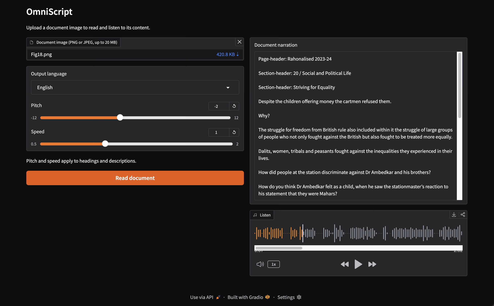

# OmniScript

OmniScript turns document images into readable text and multilingual audio. It
combines document layout detection, OCR, picture captioning, image-text matching,
translation, and speech synthesis.

## Research foundation

This project is based on my co-authored research paper,
[**Multimodal book reader with multilingual support**](https://doi.org/10.1007/s11042-026-21145-5),
published in *Multimedia Tools and Applications* (Springer, 2026).

> Rajalakshmi S, Nishaanth R, Shrijith M R, and Angeldeborah S.
> “Multimodal book reader with multilingual support.”
> *Multimedia Tools and Applications*, 85, article 75 (2026).
> DOI: [10.1007/s11042-026-21145-5](https://doi.org/10.1007/s11042-026-21145-5).

The research explores accessible reading of textual and visual document content.
This repository develops that work into a Python application, migrating the
notebook implementation into modular inference code and deployable services.
The current application and its supported languages may differ from the system
and experiments described in the paper.

## Project focus: multimodal ML deployment and MLOps

The main goal is to gain practical experience deploying and operating a
multimodal ML system. The work covers:

- Moving notebook inference into reusable Python modules.
- Serving GPU inference through a FastAPI backend.
- Building a Gradio interface that communicates with the backend over HTTP.
- Packaging frontend and backend services in separate Docker images.
- Managing model downloads, persistent caches, startup, and health checks.
- Testing mock and real inference paths, measuring hardware usage, and deploying
  a backend that can scale to zero.

## Deployment architecture

```text
Browser
  → Render: Gradio frontend on CPU
    → Runpod Serverless: FastAPI backend on GPU
      → Layout detection, OCR, captioning, matching, translation, speech
    ← Narration text and Base64-encoded WAV audio
  ← Text display and audio playback
```

| Component | Hosting | Entry point | Dockerfile | Container port |
| --- | --- | --- | --- | --- |
| Frontend | Render | `src.frontend:app` | `Dockerfile.frontend` | 7860 |
| Backend | Runpod Serverless Load Balancer | `src.api:api` | `Dockerfile` | 8000 |

The Gradio server calls the backend's `/process` endpoint using
`OMNISCRIPT_API_URL` and a server-side `RUNPOD_API_KEY`. The browser does not
receive the API key. The backend returns narration and audio in one response.
Uploaded images are processed temporarily, and Gradio uses temporary playback
files rather than an application-level audio archive.

Model files are cached on a Runpod Network Volume mounted at `/runpod-volume`.
The backend prepares model files at startup and preloads models when
`OMNISCRIPT_PRELOAD=1`. `/ping` and `/health` provide health-check routes.

## Try the deployed frontend

**[Open OmniScript](https://omniscript-frontend-v0-1-0.onrender.com/reader/)**

1. Upload a PNG or JPEG document image, up to 20 MB.
2. Select an output language.
3. Optionally adjust pitch and speed for headings and descriptions.
4. Click **Read document** to view the narration and play the audio.

The current interface supports English, Tamil, Hindi, Telugu, Malayalam, and
Kannada. The first request after inactivity can take longer while the frontend
or GPU worker starts and models load.

## Sample output

The example below shows the narration and audio playback interface after
processing [the sample document](samples/Fig18.png) in English.



## Test locally

Run commands from the repository root. The examples below use a POSIX shell
such as Bash or Zsh.

### 1. Install lightweight dependencies

Use Python 3.12 to match the tested backend environment:

```bash
python3.12 -m venv .venv
source .venv/bin/activate
python -m pip install -r requirements-local.txt
```

These dependencies support the frontend and mock API without downloading the
large inference models.

### 2. Test both services locally with mock inference

Start the mock backend in the first terminal:

```bash
OMNISCRIPT_MOCK=1 OMNISCRIPT_PRELOAD=0 \
python -m uvicorn src.api:api --host 127.0.0.1 --port 8000 --workers 1
```

In a second terminal, activate the same environment and start the frontend:

```bash
source .venv/bin/activate
unset RUNPOD_API_KEY
OMNISCRIPT_API_URL=http://127.0.0.1:8000 \
python -m uvicorn src.frontend:app --host 127.0.0.1 --port 7860
```

Open **http://127.0.0.1:7860/reader/** and upload an image. Mock mode returns
sample narration and a short tone; it checks the API/UI integration without
performing OCR, translation, or real speech synthesis. The mock API documentation
is available at **http://127.0.0.1:8000/docs**.

Run the automated checks in the activated environment:

```bash
OMNISCRIPT_MOCK=1 OMNISCRIPT_PRELOAD=0 \
python -m unittest discover -s tests -p "test_mock_api.py" -v
OMNISCRIPT_MOCK=1 OMNISCRIPT_PRELOAD=0 \
python -m unittest discover -s tests -p "test_ui.py" -v
```

### 3. Test a local frontend with real Runpod inference

With the environment activated, set `OMNISCRIPT_API_URL` to the deployed
endpoint URL and provide `RUNPOD_API_KEY` in the same terminal. Replace the
placeholders below with your deployment settings:

```bash
export OMNISCRIPT_API_URL="https://<endpoint-id>.api.runpod.ai"
export RUNPOD_API_KEY="<your-runpod-api-key>"
python -m uvicorn src.frontend:app --host 127.0.0.1 --port 7860
```

Open **http://127.0.0.1:7860/reader/**. Inference runs on Runpod, so this mode
does not require local model downloads or a local GPU. Stop any frontend already
using port 7860 before starting another one.

The application does not automatically load `.env`; configure environment
variables in the launching process or hosting platform. Keep credentials out of
source control and Docker images.

### Running real inference on local hardware

The mock setup above is not sufficient for local model inference. Real inference
requires `requirements.txt`, model assets, and system tools including Tesseract,
FFmpeg, and Rubber Band, plus enough RAM and GPU memory for the models.
The backend `Dockerfile` and `scripts/runpod/` contain the environment
preparation and model-check scripts.

## Deploy the frontend image

The frontend entry point is `src/frontend.py`. Its image copies only the package
initializer, frontend application, and UI module; inference models are not loaded
by this service.

Build and push a new image tag, for example `v0.1.1`:

```bash
docker buildx build \
  --platform linux/amd64 \
  -f Dockerfile.frontend \
  -t nishcreed/omniscript-frontend:v0.1.1 \
  --push .
```

Update the existing Render service's image reference to
`docker.io/nishcreed/omniscript-frontend:v0.1.1` and deploy it. Keep
`OMNISCRIPT_API_URL` and `RUNPOD_API_KEY` configured in Render. If a custom Docker
command was set on the service, clear it to use the image's command, or update it
to `python -m uvicorn src.frontend:app --host 0.0.0.0 --port 7860`.
The service continues to serve the UI at `/reader/`.

## Deployment notes

See [deployment decisions and observations](docs/deployment-notes.md) for
architecture rationale, troubleshooting findings, the earlier Pod testing
workflow, and measured resource usage. Detailed measurements are recorded in
[hardware requirements](docs/hardware-requirements.md).
